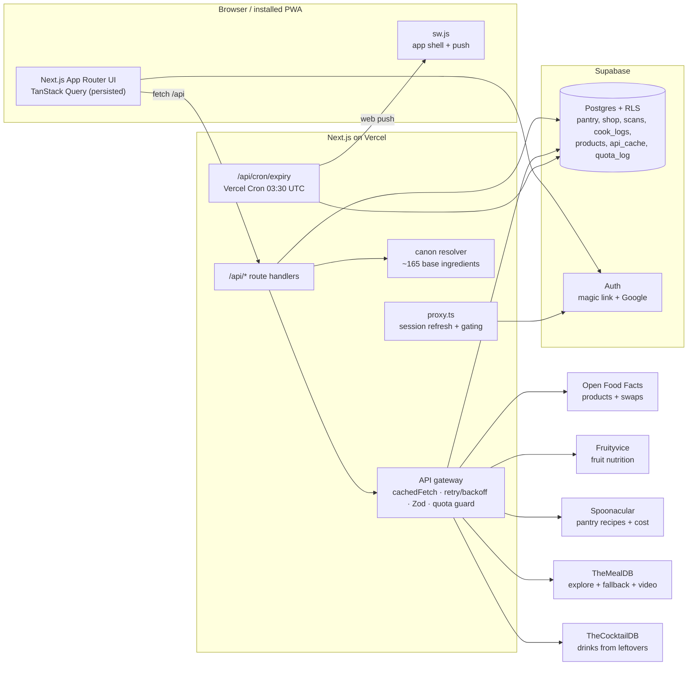

# NutriLens

**Scan it, know it, use it up.** A smart kitchen app that tells you what's in your food, tracks what's in your pantry, and makes sure you eat it before it expires. India-first (₹, vegetarian / Jain / vegan diets, IST), works anywhere.

1. **Scan** a barcode, or add fresh fruit by name.
2. **Score** it: Nutri-Score, NOVA, allergens (red alert naming the housemate affected), additives, real-fruit sugar check, better swaps.
3. **Store** it in a shared household pantry with a suggested expiry date.
4. **Use** it: recipes and drinks ranked by what's about to expire; cook mode deducts what you used.
5. **Shop** for what's missing with a ₹ estimate; scanning a bought item ticks it off and adds it to the pantry.

## Screenshots

| Home | Health Score | Pantry | Cook mode |
|---|---|---|---|
| _add `docs/home.png`_ | _add `docs/product.png`_ | _add `docs/pantry.png`_ | _add `docs/cook.png`_ |

## Architecture



No secret ever reaches the browser: the five APIs are only called from `src/lib/apis/*` (all `server-only`), behind our own `/api` routes.

## How each API is used

| API | Used for | Where |
|---|---|---|
| **Open Food Facts** | Product by barcode (limited `fields`, custom User-Agent), better swaps from the same category | `src/lib/apis/off.ts` |
| **Fruityvice** | Fruit autocomplete (`/all`, cached a week), fruit card, real-fruit sugar comparison. Server-only because CORS is off | `src/lib/apis/fruityvice.ts` |
| **Spoonacular** | "Use it up" (`findByIngredients`, expiring first, `ranking=1`), recipe detail, shopping cost (`parseIngredients`, US cents → ₹). Guarded by a daily points budget | `src/lib/apis/spoonacular.ts`, `src/lib/quota.ts` |
| **TheMealDB** | Explore (cuisine, category, search, random), cook mode YouTube video, automatic "Use it up" fallback | `src/lib/apis/mealdb.ts`, `src/lib/useitup.ts` |
| **TheCocktailDB** | Drinks from leftovers, non-alcoholic unless every member opts in | `src/lib/apis/cocktaildb.ts`, `src/lib/drinks.ts` |

Endpoint-by-endpoint table with cache TTLs: [API_USAGE.md](API_USAGE.md). Design calls and deviations: [DECISIONS.md](DECISIONS.md).

## Run it locally (≈15 minutes)

Needs **Node 20.9+** (developed on Node 24) and a free **Supabase** project.

1. **Install**

   ```bash
   npm install
   ```

2. **Create a Supabase project** at [supabase.com](https://supabase.com) → New project. Then go to Project Settings → API and copy the URL, the anon key and the service_role key.

3. **Environment**

   ```bash
   cp .env.example .env.local
   ```

   Fill in the three Supabase values. Optional extras: a `SPOONACULAR_KEY` (free at spoonacular.com/food-api/console; without it "Use it up" uses TheMealDB), and VAPID keys for push (`npm run gen:vapid` prints them).

4. **Run the migration.** Either paste `supabase/migrations/20261027000000_init.sql` into the Supabase dashboard → SQL Editor → Run, or use the CLI:

   ```bash
   npx supabase link --project-ref <your-project-ref>
   npx supabase db push
   ```

5. **Auth settings** (dashboard → Authentication):
   - URL Configuration → Site URL `http://localhost:3000`, and add `http://localhost:3000/**` to Redirect URLs.
   - Google sign-in (optional): Providers → Google → add your Google OAuth client ID/secret.
   - Optional, for links opened in a different browser: Email Templates → Magic Link → set the link to
     `{{ .SiteURL }}/auth/confirm?token_hash={{ .TokenHash }}&type=email&next=/home`

6. **Seed the demo data**

   ```bash
   npm run seed
   ```

   This creates the household **Demo Flat 4B** (invite code `de30f1a7`) with ~17 pantry items (some expiring today/tomorrow), 6 months of used/wasted history, scans, a cook log and a shopping list. Users: `demo@nutrilens.app` (Riya, vegetarian) and `asha@nutrilens.app` (nut allergy, so the seeded Nutella turns red), plus `e2e@nutrilens.app` for tests.

   To look around as the demo user without an inbox, sign in with your own email, then open the invite link `http://localhost:3000/join/de30f1a7` to join the demo household.

7. **Start**

   ```bash
   npm run dev
   ```

   Open http://localhost:3000. Camera scanning needs `localhost` or HTTPS. On a phone on the same Wi-Fi, use a tunnel such as `npx localtunnel --port 3000`, or type barcodes manually (try `8902579000370` Frooti, `3017624010701` Nutella).

## Scripts

| Command | What it does |
|---|---|
| `npm run dev` | Dev server |
| `npm run typecheck` | `next typegen` + `tsc --noEmit` |
| `npm run lint` | ESLint |
| `npm run test` | Vitest unit tests (recorded fixtures, no live calls) |
| `npm run build` / `npm start` | Production build / serve |
| `npm run test:e2e` | Playwright smoke test (needs a seeded Supabase + a running build; run `npx playwright install chromium` once) |
| `npm run seed` | Rebuild the demo + e2e households |
| `npm run gen:vapid` | Print a VAPID key pair for push |
| `npm run gen:icons` | Regenerate the PWA icons from the SVG |

**Live RLS test (optional):** set `RLS_TEST_SUPABASE_URL`, `RLS_TEST_ANON_KEY` and `RLS_TEST_SERVICE_KEY` (use a dev project — it creates and deletes two throwaway users), then `npm test`. It checks that one household can't read or write another's pantry. Without them, only the static migration checks run.

## Deploy (Vercel + Supabase)

1. Push the repo to GitHub and import it in Vercel (framework preset: Next.js).
2. Add every variable from `.env.example` in Vercel → Settings → Environment Variables. Set `NEXT_PUBLIC_APP_URL` to your production URL and `CRON_SECRET` to a long random string.
3. In Supabase → Authentication → URL Configuration, set the Site URL to the Vercel URL and add `https://<your-app>.vercel.app/**` to Redirect URLs. If you use Google, add the same callback to the Google OAuth client.
4. Deploy. `vercel.json` registers the daily cron (`30 3 * * *` UTC = 09:00 IST) for `/api/cron/expiry`; Vercel sends `Authorization: Bearer $CRON_SECRET` automatically.
5. Check it: open the site on a phone → Add to Home Screen (it's a PWA) → Settings → Enable reminders → Send a test.

## Project layout

```
src/app            routes (pages + /api route handlers), proxy.ts
src/components     ui (shadcn) + feature components
src/lib/apis       one client per external API (server-only)
src/lib            canon resolver, cache, quota, http, supabase, domain logic
src/types          db + domain + api response types
supabase/          migration (schema, RLS, RPCs)
scripts/           seed, VAPID + icon generators
tests/unit         Vitest + recorded fixtures in tests/fixtures
tests/e2e          Playwright smoke test
public/sw.js       service worker
```

Data credits: product data © Open Food Facts contributors (ODbL).
